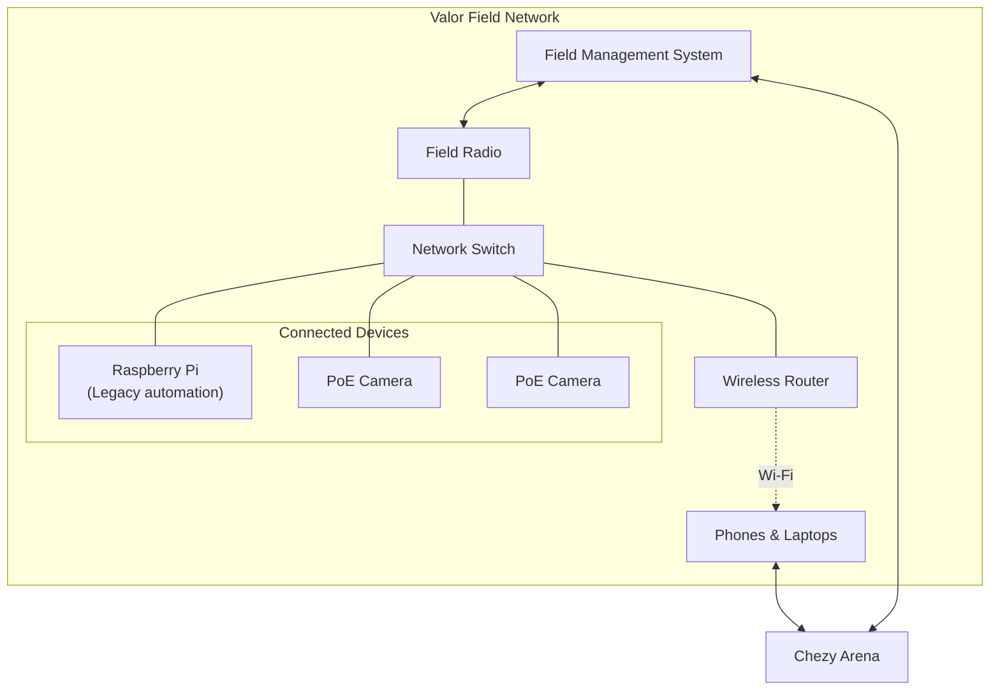
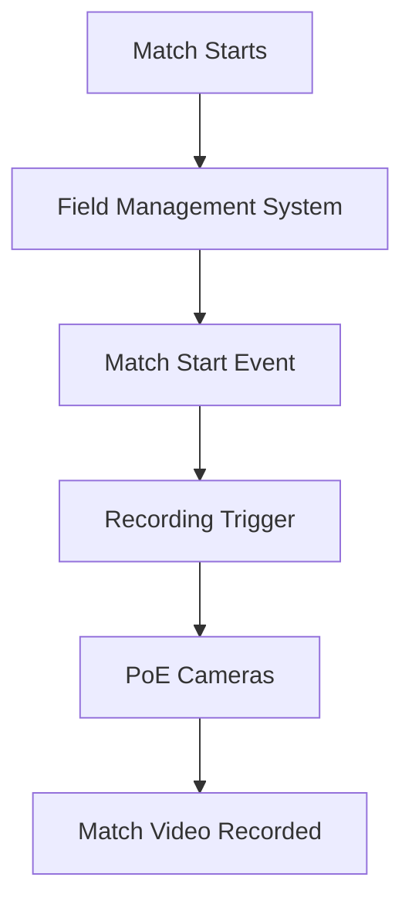

# Valor Field Network

*A reliable, automated networking infrastructure for managing FRC competition fields.*

## Overview

The Valor Field Network is the networking infrastructure used to operate our FRC practice field. It connects the field management system, robot radios, cameras, and other field devices into a single network.

We have been using this setup for almost a year, and it has proven highly reliable, working successfully through nearly every match and practice session.

Over time, we have expanded the system to support automated team assignments, match coordination through Chezy Arena, and automatic video recording.

## Architecture and Technologies

The field network connects several components:

- **Field Management System:** Manages team assignments and match operation through the field radio.
- **Raspberry Pi:** Originally ran a custom script to persist team number assignments across field radio reboots.
- **Chezy Arena:** Coordinates matches involving multiple robots and provides a centralized interface for field operation.
- **PoE Cameras:** Connected directly to the field network for match recording.
- **Wireless Router:** Provides Wi-Fi access to the field network, allowing users to interact with Chezy Arena from their phones and laptops.

## Custom Field Radio Automation

Originally, we used a custom Python script running on a Raspberry Pi to maintain team number assignments on the field radio.

The field radio would occasionally lose its team assignments after a reboot, requiring them to be configured again manually.

I developed a script that automatically restored and persisted these assignments, eliminating the need for repeated manual configuration.

This solution remained part of our field infrastructure until we transitioned to Chezy Arena.

## Chezy Arena Integration

We recently transitioned to **Chezy Arena** to coordinate matches involving multiple robots.

Chezy Arena provides a centralized interface for managing matches and field operation, making it easier to coordinate larger practice sessions.

To make the system more accessible, we also added a wireless router to the field network. Anyone connected to the Wi-Fi network can interact with Chezy Arena from a phone or laptop without needing a direct wired connection.

## Automated Match Recording

One of the more recent additions to the field network is automated match recording.

We successfully integrated Power over Ethernet (PoE) cameras directly into the field network.

The cameras are configured to automatically begin recording when a match starts. This removes the need for someone to manually start each recording and makes it easier to capture every match consistently.

Combining the cameras with the field management system allows recording to become part of the normal match workflow.

## Results

The field network has been in regular use for almost a year and has become a dependable part of our robotics infrastructure.

Key accomplishments include:

- Nearly a year of reliable field network operation.
- Automated team number persistence using a custom Raspberry Pi script.
- Transition to Chezy Arena for coordinating matches with multiple robots.
- Successful integration of PoE cameras.
- Automatic camera recording triggered by match start.
- Wireless access to Chezy Arena from phones and laptops.

## Technologies Used

| Category | Technology |
|---|---|
| Field management | FRC Field Radio |
| Match coordination | Chezy Arena |
| Automation | Python |
| Hardware | Raspberry Pi |
| Cameras | PoE Cameras |
| Networking | Ethernet / Wi-Fi |
| Network hardware | Wireless Router |

## Summary

The Valor Field Network has evolved from a basic FRC field network into a more complete system for managing matches, connecting robots, and recording practice sessions.

Through custom automation and integration with Chezy Arena, we have reduced manual setup and made the field easier for the entire team to use.

The project demonstrates how networking, automation, and hardware integration can improve the reliability and usability of robotics infrastructure.