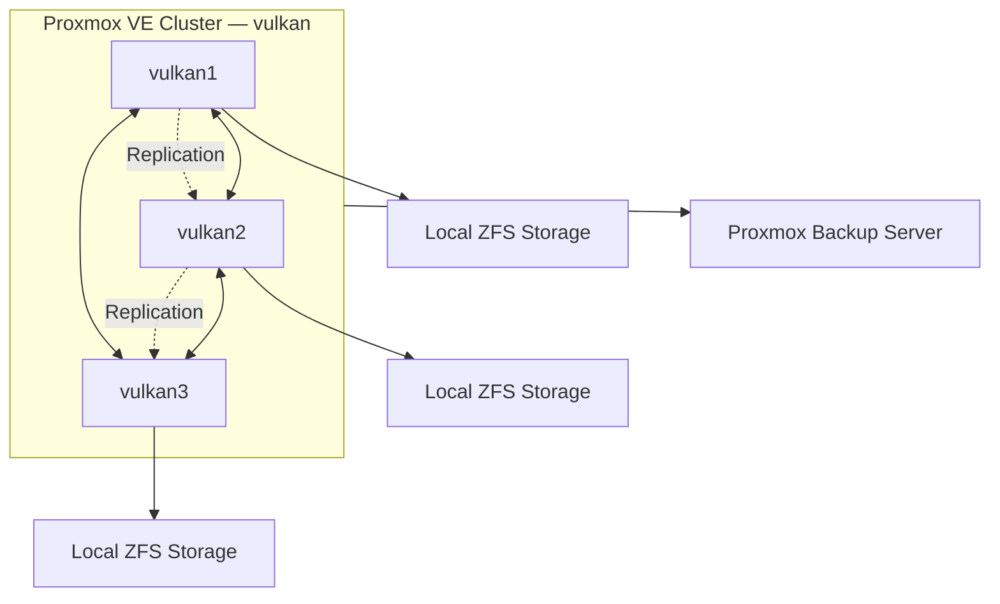

# Proxmox Homelab Cluster

*A three-node virtualization cluster built with Proxmox VE, ZFS, and Proxmox Backup Server.*

## Overview

I built a three-node Proxmox VE cluster to host virtual machines, containers, and self-hosted services. The cluster provides a centralized environment for managing compute resources, storage, and workloads across multiple physical machines.

The cluster, named `vulkan`, consists of three nodes:

| Node | Hostname |
|---|---|
| 1 | `vulkan1` |
| 2 | `vulkan2` |
| 3 | `vulkan3` |

All three nodes participate in the same Proxmox cluster, allowing me to manage workloads and infrastructure from a single interface.

The cluster is designed around local ZFS storage, inter-node replication, and centralized backups. This provides flexibility when moving workloads between nodes and recovering from hardware failures.

## Architecture

The cluster uses a combination of virtualization, containerization, and storage technologies.

- **Proxmox VE** provides the virtualization platform and centralized cluster management.
- **KVM/QEMU** runs full virtual machines.
- **LXC** provides lightweight Linux containers.
- **ZFS** manages local storage and provides snapshots and replication.
- **Proxmox Backup Server** provides centralized, incremental backups.
- **Corosync/KNET** handles cluster communication and quorum.

### Cluster Layout

## Virtualization

Proxmox VE serves as the foundation of the cluster, providing a unified interface for managing virtual machines and containers.

I use both KVM virtual machines and LXC containers depending on the requirements of each workload. KVM provides full hardware virtualization, while LXC offers a lightweight alternative for Linux-based services.

## Storage and Replication

Each node uses local ZFS storage for virtual machine and container disks.

ZFS provides copy-on-write storage, checksumming, snapshots, and incremental replication. Proxmox uses ZFS snapshots to transfer changes between nodes, maintaining replicas of selected workloads without repeatedly transferring their entire disks.

This allows workloads to be prepared for migration or recovery on another node.

## Backups

The cluster uses Proxmox Backup Server (PBS), deployed in a dedicated LXC container.

PBS provides incremental, deduplicated backups of virtual machines and containers. It complements ZFS replication by maintaining independent backup data that can be used to restore workloads to previous states.

## Cluster Management and Reliability

The three nodes communicate using Corosync with the KNET transport.

The cluster uses a three-vote quorum configuration, requiring two nodes to remain available for quorum. This allows the cluster to continue operating if one node becomes unavailable.

Proxmox's integrated management tools handle workload migration, replication scheduling, storage management, and cluster administration.

## Technology Stack

| Category | Technology |
|---|---|
| Virtualization | Proxmox VE |
| Virtual machines | KVM / QEMU |
| Containers | LXC |
| Storage | OpenZFS |
| Replication | ZFS send/receive |
| Backups | Proxmox Backup Server |
| Cluster communication | Corosync / KNET |
| Cluster configuration | pmxcfs |
| Monitoring | Grafana Alloy |
| Container management | Proxmox VE |

## Goals

The cluster serves as the foundation of my homelab and provides an environment for hosting services and experimenting with infrastructure technologies.

My primary goals are to maintain a flexible virtualization environment, improve workload reliability through replication and backups, and gain hands-on experience with Linux, virtualization, distributed systems, and storage technologies.